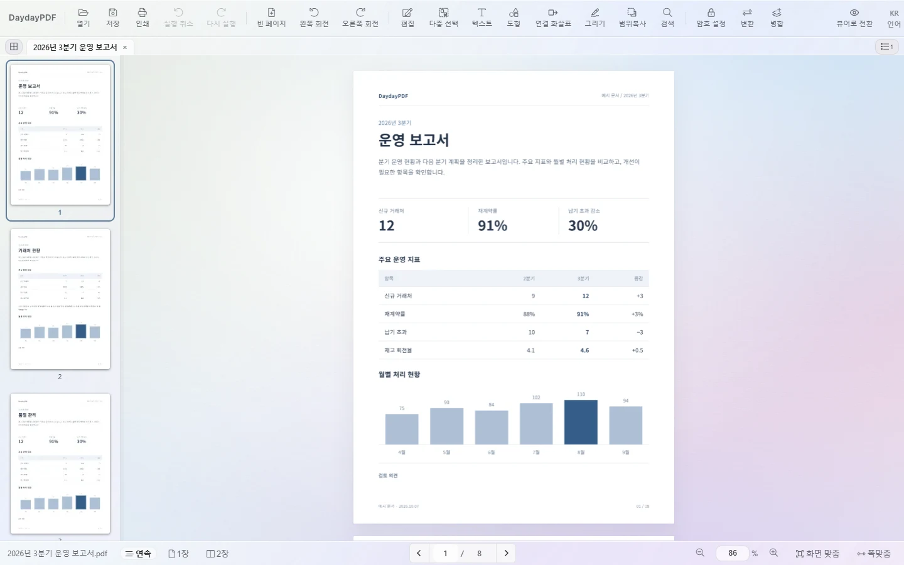
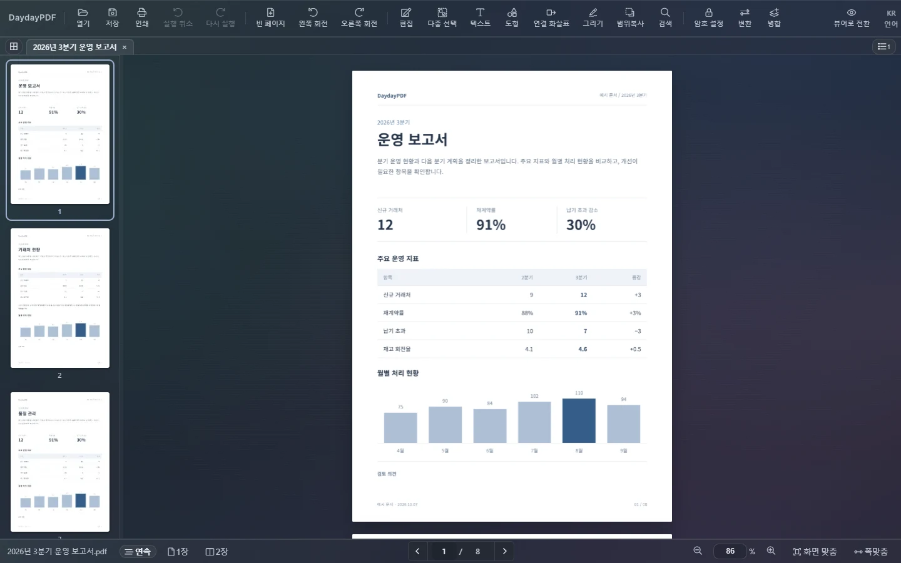

# DayDayPDF for Windows

DayDayPDF는 Windows에서 PDF에 글을 쓰고, 페이지와 개체를 편집하고 인쇄할 수 있는 데스크톱 앱입니다. PDF 읽기와 편집은 PC에서 처리합니다.

## 편집 화면

| 라이트 글래스 | 다크 글래스 |
| :---: | :---: |
| [](docs/screenshots/editor-glass-light-1440.webp?raw=true) | [](docs/screenshots/editor-glass-dark-1440.webp?raw=true) |

## 설치

Windows 10/11 x64에서 사용합니다. [릴리스](https://github.com/sol1010/DayDayPDF-Windows/releases)에서 원하는 버전의 `DayDayPDF.Setup.exe`를 실행하세요. 앱 화면에는 WebView2 Runtime이 필요합니다.

설치 프로그램은 Windows 기본 드라이버로 DaydayPDF 가상 프린터 하나를 등록합니다. 드라이버나 프린터 포트를 추가할 때 Windows에서 관리자 권한을 요청할 수 있습니다. 인쇄 수신기는 로그인할 때 실행됩니다. 수신기가 종료되거나 응답을 멈추면 자동으로 다시 실행해 대기열의 인쇄를 이어서 처리합니다.

제거하면 앱과 가상 프린터가 삭제됩니다. 자동 저장한 문서와 세션 목록은 사용자 계정의 `%LOCALAPPDATA%\SolPdfEditor\Preview`에 보관됩니다. 완전히 지우려면 필요한 문서를 저장하고 앱을 종료한 뒤 해당 폴더를 삭제하세요.

## 자동 업데이트

설치본의 **설정 → 일반 설정 → 자동 업데이트**를 켜면 바로 새 버전을 확인합니다. 앱을 다시 시작하거나 켜 둔 채 12시간이 지나도 확인합니다. 다운로드가 끝나면 마지막 창을 정상적으로 닫을 때 설치하며, 다음 실행부터 새 버전을 사용합니다. 토글을 끄면 다운로드와 예약된 설치가 취소됩니다. 기본값은 꺼짐입니다.

업데이트는 이 공개 저장소의 최신 정식 릴리스를 사용합니다. 배포할 때 소스와 설치 파일의 버전을 일치시키고, 해당 커밋에 네 자리 버전 태그(예: `v26.11.24.3`)로 정식 릴리스를 만드세요. `DayDayPDF.Setup.exe`, `DayDayPDF.exe`, `SHA256SUMS.txt`를 첨부하고 최신 릴리스로 지정합니다. 앱은 설치 파일의 크기, GitHub가 제공하는 SHA-256, 파일 버전을 확인합니다. 초안과 사전 릴리스는 자동 업데이트 대상에서 제외됩니다.

## 인쇄

인쇄 창에서 **DaydayPDF**를 선택하세요. 지원하는 인쇄 작업에는 고속 변환이 자동으로 적용됩니다. 기본 용지는 A3 가로이며 인쇄 창에서 원본에 맞게 변경할 수 있습니다. 프린터 상태는 **준비**, 위치는 **이 PC**로 등록됩니다. PDF 변환이 실패하면 원본 작업을 대기열에 보관하고 자동으로 다시 시도합니다.

파일 메뉴에서 **인쇄**를 열고 용지를 **자동 (원본 크기)**로 선택하면 페이지마다 PDF의 크기와 방향을 사용합니다. 실제 출력 영역과 급지할 수 있는 용지는 프린터에 따라 다릅니다. 용지 크기나 방향이 바뀌면 별도 작업으로 전송하므로 양면 인쇄에서는 새 용지로 시작합니다.

인쇄 준비 중에는 **Esc**로 취소할 수 있습니다. 프린터 전송이 시작되면 **Esc**로 아직 보내지 않은 작업을 취소할 수 있습니다. 이미 보낸 작업은 Windows 인쇄 대기열에서 파일명을 찾아 취소하세요.

## 빌드

Windows x64, Node.js 22 이상, .NET 10 SDK가 필요합니다. SDK 버전은 `windows/global.json`에서 확인할 수 있습니다. 저장소 루트의 PowerShell에서 실행합니다.

```powershell
.\windows\build-release.ps1
npm test
```

설치 프로그램, 단독 실행 파일, SHA-256 목록은 `windows/artifacts/`에 생성됩니다. 편집 화면의 소스는 `src/`에, Windows 호스트와 설치 프로그램은 `windows/`에 있습니다.

보안 문제를 발견하면 [비공개 신고 안내](SECURITY.md)를 확인하세요.

## 라이선스

DayDayPDF의 PC 소스와 직접 제작한 도구 아이콘에는 [GPL-3.0-only](LICENSE)가 적용됩니다. 외부 라이브러리와 함께 배포하는 글꼴의 고지는 [THIRD_PARTY_NOTICES.txt](THIRD_PARTY_NOTICES.txt)에 있습니다. PC에 설치된 시스템 글꼴은 실행 시 조회합니다.
